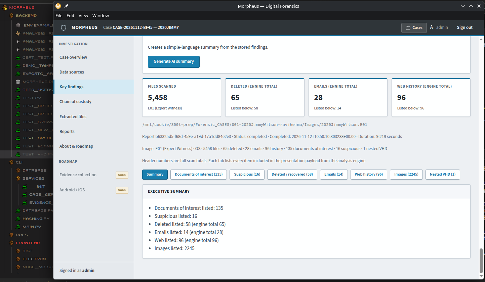
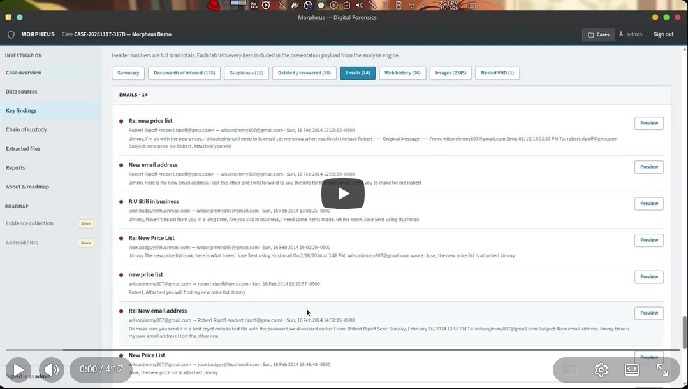

# Morpheus Forensics Workspace (Hackathon Sample)

Morpheus is a unified digital forensics workspace. The core is built with Python and the GUI is built with React and Electron.

## Preview

<!-- TODO: save your screenshot as docs/preview.png and commit it -->


<!-- TODO: replace YOUR_VIDEO_ID with the real video id (and add docs/video-thumbnail.png), or drag the mp4 into the GitHub editor and paste the link it gives you here -->
[](https://youtu.be/oGOyBPky09o)

## Features

- Chain of Custody + Audit Log
- Data Source Integrity Verification
- Access Control
- Automated Report Generation
- Forensics Analysis (.E01, tested on NTFS and FAT32 filesystems) with automated:
  - Web History Parsing
  - Email Parsing
  - Documents / Text Files Parsing
  - Smart Artefact Detection (Suspicious)
  - Deleted Files Recovery
  - Hidden Virtual Disk Detection/Parsing (_currently supports VHD_)
  - AI Investigation Summary (WIP)
  - File Extraction

**WIP:**
- Event Log Parsing
- Registry Hives Parsing
- GUI (partly done, the rest is still in progress)
- Timeline

## Installation

> **Requirements**
> - Node.js 18+ and npm
> - Python 3.10+ recommended
> - Git

```bash
git clone https://github.com/raviheima/Morpheus --depth=1
cd Morpheus
```

### Recommended setup

Use the setup script to quickly install the required dependencies and run the program.

```bash
python setup.py
```

### Manual setup

#### Backend

```bash
python -m venv .venv
source .venv/bin/activate   # on Windows: .venv\Scripts\activate
pip install -r requirements.txt
cd backend

# optional, for the AI generated summary
cp .env.example .env

uvicorn app.main:app --reload --host 0.0.0.0 --port 8000
```

#### Frontend

Keep the backend running and open a separate terminal for this one.

```bash
npm install
cd frontend
npm run dev
```

Heads up: the Electron binary is large and the program will try to download it on first run.

If you're comfortable typing the full path of the image file you want to scan, you can skip Electron and use plain React instead:

```bash
npm run react:dev
```

The GUI is self explanatory. If you followed the steps above you should be able to run it.

### Demo accounts

Hardcoded Default accounts and their roles for GUI usage:

| Username | Password | Role |
|----------|----------|------|
| admin | admin123 | Full administration |
| examiner | exam123 | Create and analyze cases |
| viewer | view123 | Read-only access |

## Usage

### CLI

```bash
python main.py
```

### Orchestrator

If you want to see in detail what the backend orchestrator does, update the image path in the script and run:

```bash
python backend/test_orchestrator.py
```


## Test images

These are the images Morpheus was tested on:

- **FAT32 USB image:** [terry-work-usb-2009-12-11.E01](https://github.com/BitCurator/bitcurator-access-webtools/raw/main/disk-images/mixed/terry-work-usb-2009-12-11.E01) 
- **Windows OS disk image (2020JimmyWilson):** [NIST CFReDS page](https://cfreds.nist.gov/all/DFIR_AB/ForensicsImageTestimage)


## The Story

**This project was made under constraints.** 

1. **Power supply:** there was no power. My home transformer got faulty and my team member didn't have a stable power supply either at the time.
2. **Rushing:** because of that we were rushing to meet the submission deadline. I started on the CLI version from my phone, and about halfway through I decided we use **AI** to write the components so we could meet up, also I only had free tier models to work with. My role was thinking, and library research. I’d ask the AI for one component at a time (write one that does x, then one that does y), then piece them together and keep going. It was mostly a spec review thing since I couldn’t trust the AI to replicate my intent on its own.

### Technical decisions

- **Forensic workflow:** inspired by a coursework write-up, [Investigating the 2020JimmyWilson E01 disk image](https://raviheima.me/hacking/digital-forensics-investigating-the-2020jimmywilsone01-disk-image/).The hackathon spec was an integrity check, chain of custody log, evidence collection.
- **Electron:** browsers restrict file path access, so Electron.
- **Python:** robust libraries for forensics.
- **React:** it's what I'm more conversant with compared to a Python GUI library.
- **No file uploads:** forensic images are usually large, so you pass the file path to the backend and it processes the image from there. This means the image has to be accessible on the machine running the program.
- **The orchestrator:** given the time constraint, I figured automating the workflow would be faster than building a fully fledged interactive UI that does the same thing. 
- **Windows workflow (for now):** that's the forensics workflow I'm familiar with, so that's what the current version is built around. It supports E01 images.
- **What's actually tested:** the 2020JimmyWilson image (a Windows OS disk image) and a FAT32 USB .E01 image. I was rushing so I didn't test much beyond that, which means I can't say much on how it behaves on anything else.


## What's next

I intend to write a more functional version later. After our forensics class, using Autopsy on Linux was an incomplete experience compared to Windows, and as a Linux user that didn't sit well with me. So I'm considering contributing to the Linux version or creating a user-friendly Linux forensics tool.

## Libraries

**CLI and terminal**
- `typer[all]`: typed CLI and argument validation, so I'm not hand-rolling argument parsing.
- `rich`: makes the terminal output look good, with progress bars and status displays.

**API and persistence**
- `sqlalchemy`: ORM models, sessions and queries, so I'm not writing raw SQL everywhere.
- `fastapi`: the HTTP API, routing, dependency injection and the OpenAPI docs.
- `uvicorn`: runs the FastAPI app.
- `python-multipart`: form/file parsing in FastAPI endpoints.
- `pydantic`: validates request and response data.

**Digital forensics and evidence formats**
- `pytsk3`: The Sleuth Kit in Python. This is how we read filesystems and forensic images.
- `libewf-python`: reads E01/Ex01 images.
- `libvhdi-python`: reads VHD/VHDX virtual disks.
- `libesedb-python`: reads ESE databases, which is how browser artefacts get parsed.

**Reporting and security**
- `fpdf2`: generates the PDF case reports and integrity/custody certificates.
- `python-jose[cryptography]`: JWT creation and verification for API auth.
- `passlib[bcrypt]`: password hashing.
- `email-validator`: validates examiner and account emails.
- `python-dotenv`: loads local backend config from `.env`.

## Contributing

If you're interested in working on the full version with me, send me an email at hello@raviheima.me.


## Contributors

- **[Raviheima](https://github.com/raviheima):** backend, CLI and the forensics workspace.
- **[Cyphora-ux](https://github.com/Cyphora-ux):** landing page.

## License

[MIT](https://opensource.org/license/mit)
